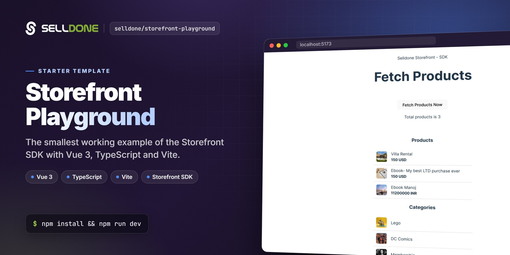

<p align="center">
  
</p>

<p align="center">
  <a href="https://github.com/selldone/storefront-playground/wiki"></a>
  <a href="https://selldone.com"></a>
</p>

<p align="center">
  <b>A minimal Vue 3 + TypeScript + Vite starter that shows how to load products and categories from a Selldone shop with the Storefront SDK.</b><br>
  <a href="https://github.com/selldone/storefront-playground/wiki">Documentation</a> ·
  <a href="#quick-start">Quick start</a> ·
  <a href="https://github.com/selldone">Ecosystem</a> ·
  <a href="https://selldone.com">Selldone.com</a> ·
  <a href="https://github.com/selldone/storefront-playground/issues">Report an issue</a>
</p>

<p align="center">
  <a href="https://github.com/selldone/storefront">Storefront</a> ·
  <a href="https://github.com/selldone/pagebuilder">Page Builder</a> ·
  <a href="https://github.com/selldone/components">Components</a> ·
  <a href="https://github.com/selldone/storefront-sdk">Storefront SDK</a> ·
  <a href="https://github.com/selldone/backoffice-sdk">Backoffice SDK</a> ·
  <a href="https://github.com/selldone/vendor-sdk">Vendor SDK</a> ·
  <a href="https://github.com/selldone/community-sdk">Community SDK</a> ·
  <a href="https://github.com/selldone/core">Core</a> ·
  <a href="https://github.com/selldone/cli">CLI</a> ·
  <a href="https://github.com/selldone/translate">Translate</a>
</p>

## Overview

**Storefront Playground** is the smallest working example of the **Selldone®** [Storefront SDK](https://github.com/selldone/storefront-sdk) (`@selldone/sdk-storefront`). This template should help you get started developing with the Selldone Storefront SDK: it is a fresh Vue 3 + TypeScript + Vite project with the SDK initialized and one component that fetches products and categories from a live shop.

The shop and API endpoints are configured with `<meta>` tags in `index.html`, exactly as on a real Selldone storefront. Change one tag (`shop-name`) to point the playground at your own shop.

Use it to learn the SDK, to try API calls quickly, or as a starting point before moving to the full [Storefront](https://github.com/selldone/storefront) project.

## Key features

- **Minimal setup** — Vue 3, TypeScript and Vite with only two runtime dependencies: `vue` and `@selldone/sdk-storefront`.
- **SDK initialization** — `SelldoneCore.Setup()` and `StorefrontSDK.Setup()` in `src/main.ts`.
- **Meta-tag configuration** — shop name, path prefix, custom home, API origins and CDNs set in `index.html`.
- **Real API call** — `window.$storefront.products` fetches products and categories, using the SDK's built-in caching (`optimize(600)` and `.cache(...)`).
- **Typed models** — uses `Product.IProduct` and `Category.ICategory` types from `@selldone/core-js`.
- **CDN image helper** — product and category icons via `window.CDN.GET_SHOP_IMAGE_PATH(...)`.

## Screenshots

<p align="center">
  
</p>

## Quick start

Requirements: Node.js and npm.

```bash
git clone https://github.com/selldone/storefront-playground.git
cd storefront-playground
npm install
npm run dev
```

Open the URL printed by Vite and click **Fetch Products Now**. By default the playground reads the demo shop `toysworld`.

To use your own shop, change the `shop-name` meta tag in `index.html`:

```html
<meta name="shop-name" content="your-shop-name">
```

## Usage

### Scripts

| Command | What it does |
|---|---|
| `npm run dev` | Start the Vite dev server. |
| `npm run build` | Type-check with `vue-tsc`, then build for production into `dist/`. |
| `npm run preview` | Serve the production build locally. |

### Shop configuration (`index.html`)

| Meta tag `name` | Default | Purpose |
|---|---|---|
| `shop-name` | `toysworld` | The shop to load. Required by `StorefrontSDK.Setup()`. |
| `shop-prefix-address` | *(empty)* | Path prefix of the app, e.g. `/my-shop-path`. |
| `custom-home` | `shop` | Custom home page of the shop (e.g. `shop`, `blog`, `landing_page`). |
| `service-url` | `https://selldone.com` | Main Selldone service origin. |
| `selldone-gapi` | `https://gapi.selldone.com` | Global API (Selldone Core). |
| `selldone-xapi` | `https://xapi.selldone.com` | Storefront API used by the Storefront SDK. |
| `selldone-iframe` | `https://iframe.selldone.com` | Iframe service origin. |
| `selldone-capi` | `https://capi.selldone.com` | Community API. |
| `selldone-cdn-images`, `-jsons`, `-videos`, `-temp-files`, `-ar`, `-id` | `https://selldone.com/cdn-…` | CDN locations for images and other assets. |
| `storage-redirect`, `storage-redirect-host`, `storage-redirect-thumbnails` | `true`, `https://cdn.selldone.com`, `true` | Load files directly from cloud storage. |

### SDK setup (`src/main.ts`)

```ts
import { createApp } from 'vue'
import './style.css'
import App from './App.vue'

// ━━━ Selldone Core (gapi,...) ━━━
import { SelldoneCore } from "@selldone/core-js";
SelldoneCore.Setup();

// ━━━ Storefront SDK (xapi) ━━━
import {StorefrontSDK} from "@selldone/sdk-storefront";
StorefrontSDK.Setup(); // Set up the Shop SDK.

createApp(App).mount('#app')
```

`StorefrontSDK.Setup()` reads the shop name from `<meta name="shop-name">` and throws if it is missing. It then creates `window.$storefront`, `window.CDN`, `window.XAPI` and `window.URLS`.

### Fetch products (`src/components/FetchProducts.vue`)

```ts
window.$storefront.products
  .optimize(600)                         // reuse data cached less than 600 s ago
  .fetchProducts(null, 0, 10, {
    categories_count: 10,
    with_parent: true,
    with_page: true,
    with_total: true,
  })
  .cache(handleSuccessResponse)          // show previously cached data while the request runs
  .then(handleSuccessResponse)           // then the response
  .catch(() => { /* log error */ });
```

`handleSuccessResponse` receives `{ products, total, folders, parent }`. The component shows the total, a list of products (icon, title, price, currency, discount) and a list of categories (`folders`). Always call `.cache(...)` before `.then(...)`.

> In recent Storefront SDK versions, `fetchProducts` is a deprecated alias of `window.$storefront.products.list(...)`. Both work; prefer `list` in new code.

## Documentation

| Page | What you'll learn |
|---|---|
| [Home](https://github.com/selldone/storefront-playground/wiki) | What the playground is and where to go next. |
| [Getting Started](https://github.com/selldone/storefront-playground/wiki/Getting-Started) | Install, run, point it at your shop. |
| [Shop Configuration](https://github.com/selldone/storefront-playground/wiki/Shop-Configuration) | Every meta tag in `index.html`. |
| [Fetching Products](https://github.com/selldone/storefront-playground/wiki/Fetching-Products) | A line-by-line walkthrough of `src/`. |
| [Project Structure](https://github.com/selldone/storefront-playground/wiki/Project-Structure) | Files, scripts, TypeScript and Vite config, building. |
| [FAQ](https://github.com/selldone/storefront-playground/wiki/FAQ) | Common questions and troubleshooting. |

## How it fits in the ecosystem

The playground uses the same building blocks as a full Selldone storefront: **Selldone Core** for shared setup and models and the **Storefront SDK** for customer-facing APIs. When you need a complete shop UI — pages, basket, checkout, user profile — move on to [Storefront](https://github.com/selldone/storefront) and [Components](https://github.com/selldone/components), and deploy it as a Layout with the [Selldone CLI](https://github.com/selldone/cli).

<p align="center">
  <a href="https://github.com/selldone#ecosystem"></a>
</p>

### Related projects

| Project | Why it is relevant |
|---|---|
| [storefront-sdk](https://github.com/selldone/storefront-sdk) | The SDK this playground demonstrates (`window.$storefront`). |
| [core](https://github.com/selldone/core) | `SelldoneCore.Setup()`, shared models and types. |
| [storefront](https://github.com/selldone/storefront) | Production-ready Vue 3 storefront (a Selldone Layout). |
| [components](https://github.com/selldone/components) | Pre-built Vue 3 commerce components. |
| [cli](https://github.com/selldone/cli) | Build, zip and deploy a Layout to Selldone. |

## Contributing

Contributions are welcome. Please read the organization [contributing guide](https://github.com/selldone/.github/blob/main/CONTRIBUTING.md) and [code of conduct](https://github.com/selldone/.github/blob/main/CODE_OF_CONDUCT.md). Keep the playground minimal: new examples should each demonstrate one SDK feature.

## Security

Please do not report security vulnerabilities in public issues. Follow the [security policy](https://github.com/selldone/.github/blob/main/SECURITY.md) and email **security@selldone.com**.

## License

This repository does not currently include a license file. Please [open an issue](https://github.com/selldone/storefront-playground/issues) or contact info@selldone.com if you need licensing terms before reusing the code. The [Storefront SDK](https://github.com/selldone/storefront-sdk) and [Core](https://github.com/selldone/core) packages it depends on are distributed under their own licenses.

---
<p align="center"><sub>Part of the <a href="https://github.com/selldone">Selldone® Business OS</a> open-source ecosystem · <a href="https://selldone.com">selldone.com</a></sub></p>
